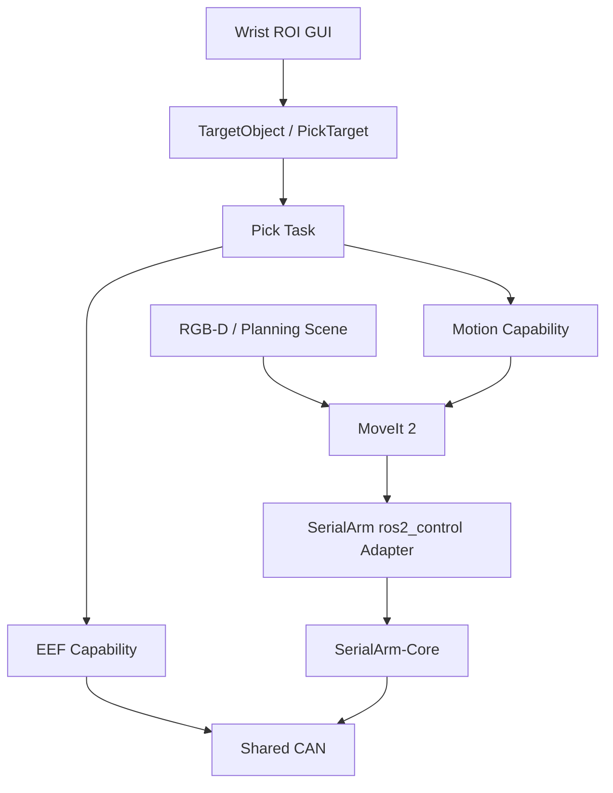

<div align="center">

# Tomato-Picker-ROS2

ROS 2 Humble + MoveIt 2 + SerialArm-Core tomato picking application stack

面向自研机械臂的末端执行器、RGB-D 感知、运动能力与采摘任务编排

[](LICENSE)
[](https://docs.ros.org/en/humble/)
[](https://moveit.picknik.ai/humble/)
[](https://github.com/Kaede-Rei/SerialArm-Core)

</div>

## 项目简介

Tomato-Picker-ROS2 是构建在 [SerialArm-Core](https://github.com/Kaede-Rei/SerialArm-Core) 之上的番茄采摘应用层

SerialArm-Core 负责机械臂模型、控制、安全、Hardware Backend、Robot Profile、ros2_control 与 MoveIt 2

Tomato-Picker 负责

- EEF 末端执行器
- MoveIt 2 运动能力封装
- RGB-D / Planning Scene 感知
- 单目标采摘阶段机
- 可选腕部 RGB-D 人工框选 GUI
- 整机部署入口

## 架构



```text
SerialArm-Core
    Robot / Control / Safety / Hardware / Profile / ros2_control / MoveIt

Tomato-Picker
    interfaces / motion / eef / perception / task / gui / bringup
```

## 当前能力

| 能力 | 入口 |
| --- | --- |
| 机械臂整机 + MoveIt 2 | SerialArm-Core `moveit.launch.py` |
| HOME / JOINT / POSE / LINE | `/tomato_picker/motion/move_arm` |
| EEF OPEN / CLOSE / STOP / SET_POSITION | `/tomato_picker/eef/command` |
| EEF 就绪状态 | `/tomato_picker/eef/ready` |
| 单目标采摘 | `/tomato_picker/task/pick` |
| 连续采摘运动学仿真 | Bringup `src/robot-profile-sim` |
| Planning Scene 开关 | `/tomato_picker/perception/set_scene_enabled` |
| GUI 框选目标 | `/tomato_picker/gui/selected_target` |

## 仓库结构

```text
Tomato-Picker-ROS2/
├── repos/
│   └── serial_arm.repos
├── src/tomato_picker/
│   ├── interfaces/    # ROS contracts
│   ├── motion/        # MoveIt capability
│   ├── eef/           # Picking tool capability
│   ├── perception/    # RGB-D / Planning Scene
│   ├── task/          # Pick behavior
│   ├── gui/           # Optional wrist ROI GUI
│   └── bringup/       # Deployment assembly
├── API.md
└── README.md
```

## Quick Start

### 1. 获取 SerialArm-Core

当前工作区跟踪 SerialArm-Core 的 `main` 分支；Tomato-Picker 通过外部 `profile_file/resource_paths` 接口持有自己的 Robot Profile；首次获取依赖，在仓库根目录执行

```bash
source /opt/ros/humble/setup.bash
vcs import src < repos/serial_arm.repos
```

已有 SerialArm-Core 仓库时，切换并更新 `main` 分支

```bash
git -C src/SerialArm-Core fetch origin main
git -C src/SerialArm-Core switch main || git -C src/SerialArm-Core switch --track origin/main
git -C src/SerialArm-Core pull --ff-only origin main
```

SerialArm-Core 的 `main` 自带一个 `tomato_picker_description` 示例包，与本工作区的正式同名包冲突；导入或更新 Core 后，应从工作区根目录执行

```bash
touch src/SerialArm-Core/src/robot_supports/robots/tomato_picker/tomato_picker_description/COLCON_IGNORE
colcon list | grep '^tomato_picker_description[[:space:]]'
```

检查输出应只包含本仓库 `src/tomato_picker/serial_arm_core_profile/tomato_picker/tomato_picker_description` 对应的一个包；`COLCON_IGNORE` 使 colcon 跳过 Core 内置的同名描述包

当前 Robot Profile 所有权

```text
tomato_picker_bringup/config/robot_profiles.yaml
  ├── core       -> tomato_picker_description
  ├── hardware   -> tomato_picker_description/config/serialarm/hardware.yaml
  ├── description-> tomato_picker_description
  ├── controllers-> tomato_picker_bringup/config/ros2_controllers.yaml
  └── moveit     -> tomato_picker_moveit_config
```

`arm.launch.py` 将这些参数传给 SerialArm-Core 的通用 `moveit.launch.py`，由 Core 启动 robot_state_publisher、ros2_control 和 controller spawner

### 2. 安装依赖并编译

从已有 workspace 更新接口后，建议先清理生成物

```bash
rm -rf build install log
```

然后

```bash
rosdep install \
  --from-paths src \
  --ignore-src \
  -r -y \
  --rosdistro humble

colcon build --symlink-install
source install/setup.bash
```

### 3. 一键启动整机

```bash
ros2 launch tomato_picker_bringup bringup.launch.py
```

启动顺序

```text
SerialArm hardware / controllers / MoveIt
    ↓ READY + stable
EEF homing
    ↓ READY
Motion
    ↓ Action READY
Task / Perception / optional GUI
```

ARM 的 Robot Profile、阻抗模式、停车逻辑与 ros2_control 生命周期全部由 SerialArm-Core 管理

主要参数

| 参数 | 默认值 | 说明 |
| --- | --- | --- |
| `robot_profile` | `dm_arm_gray` | SerialArm Robot Profile |
| `serial_port` | `/dev/ttyACM0` | 可选运行时串口覆盖，例如 `/dev/ttyACM1` |
| `baudrate` | `921600` | 可选运行时波特率覆盖 |
| `bus` | `main_can` | 可选共享 bus name 覆盖 |
| `eef_mode` | `damiao` | `damiao` / `mock` / `off` |
| `start_perception` | `true` | RGB-D Planning Scene |
| `start_gui` | `false` | 启动腕部相机框选 GUI |
| `use_sim_time` | `false` | ROS simulation time |

> serial_port / baudrate / bus 默认值为 SerialArm-Core 的 Robot Profile 配置

SerialArm runtime hardware override 会同时作用到 EEF 的共享 CAN 配置，避免 ARM 与 EEF 使用不同串口或 bus

例如机械臂枚举到 `/dev/ttyACM1`

```bash
ros2 launch tomato_picker_bringup bringup.launch.py \
  serial_port:=/dev/ttyACM1 \
  start_perception:=false
```

### 4. 检查系统

```bash
ros2 control list_controllers
ros2 action list | grep tomato_picker
ros2 service list | grep tomato_picker
```

真机模式应看到

```text
joint_state_broadcaster       active
joint_trajectory_controller   active
eef_controller                active
```

EEF

```bash
ros2 service call \
  /tomato_picker/eef/ready \
  std_srvs/srv/Trigger \
  "{}"
```

应返回

```text
success: true
message: READY
```

## 手眼标定专用 Bringup

手眼标定前先停止整机 `bringup.launch.py`，再通过专用入口启动 `RobotSession` bridge，由它独占机械臂 Hardware Backend，并发布 SerialArm-Core 已计算的末端位姿

```bash
ros2 launch tomato_picker_bringup handeye.launch.py
```

默认

```text
robot_profile = tomato_picker
pose_topic    = /arm/pose
joint_state_topic = /arm/joint_states
publish_rate  = 30 Hz
start mode    = COMPLIANT_DRAG
```

可覆盖硬件连接

```bash
ros2 launch tomato_picker_bringup handeye.launch.py \
  robot_profile:=dm_arm_gray \
  serial_port:=/dev/ttyACM0 \
  baudrate:=921600 \
  bus:=main_can
```

此入口不会启动 MoveIt、ros2_control、EEF、Task、Perception、GUI 或相机驱动，避免多个节点同时占用机械臂硬件

Handeye-Calibration-App 使用

```text
ROS2 input type = Pose
input topic     = /arm/pose
message         = geometry_msgs/msg/PoseStamped
```

发布规则

```text
RobotState == ACTIVE
AND snapshot.valid == true
AND snapshot.last_error is empty
        ↓
发布 /arm/pose、/arm/tool_transform、/arm/joint_states（同一快照、同一发布时刻）
```

因此 FAULT 期间以及 `clear_fault()` 后第一个新有效控制周期到来之前都不会发布旧位姿

用于手眼标定诊断的关节反馈来自同一 `RobotSession.snapshot.dynamics`（与 `tool_pose` 共享 FK 周期），并与 `snapshot.cycle.joint_state` 交叉核对，标准话题为 `/arm/joint_states`，消息类型为 `sensor_msgs/msg/JointState`，`name` 按 Profile 中的 `joint_names` 顺序，`position` 是弧度、`velocity` 是弧度每秒、`effort` 是关节反馈力矩（Nm）；这三个话题携带相同的 **ROS 发布时刻** 时间戳，便于记录和对应；它不是电机反馈的原始采样时间戳；拖拽标定时不要同时启动 ros2_control 以获取另一个 `/joint_states`

```bash
ros2 topic echo /arm/joint_states
ros2 topic echo /handeye/status
ros2 bag record -o handeye_diagnosis /arm/pose /arm/tool_transform /arm/joint_states /handeye/status
```

`/handeye/status` 提供 `joint_state_source=dynamics`、`joint_state_consistent` 和各关节向量的最大偏差，若 `joint_state_consistent=false`，先记录日志并排查实际安装的 Python 模块及运行配置，机器人姿态仍由同一 FK 快照提供；若动力学快照缺失或无效，桥接节点拒绝发布该周期的全部机器人姿态信息，避免写入错误的标定数据；启动日志的 `Hand-eye sources` 会输出实际加载的 Profile、Core 配置、硬件配置与 Python 模块位置

修改源码后执行 `colcon build --symlink-install` 并 `source install/setup.bash`，启动手眼节点后核对 `Hand-eye sources` 中的构建路径；如 `/arm/pose` 与标定板的运动学仍不满足固定目标一致性，继续检查标定板固定状态及相机与末端连接的刚性

### FAULT 在线恢复

可恢复的 `FAULT + fault_holding` 下，SerialArm-Core worker 持续维护 fault hold；bridge 提供以下恢复接口

```text
/handeye/fault/clear               std_srvs/srv/Trigger
/handeye/fault/compliant_recovery  std_srvs/srv/Trigger
/handeye/fault/rigid_hold           std_srvs/srv/Trigger
/handeye/drag/enable                std_srvs/srv/Trigger
```

普通瞬态可恢复 FAULT，例如偶发 `INVALID_DT`，推荐流程

```text
COMPLIANT_DRAG
    ↓
FAULT + RIGID_HOLD
    ↓
等待 fault hold 稳定
    ↓
/handeye/fault/clear
    ↓
ACTIVE + RIGID_HOLD
    ↓
等待新的 valid snapshot
    ↓
/handeye/drag/enable
    ↓
COMPLIANT_DRAG
```

命令

```bash
ros2 service call /handeye/fault/clear std_srvs/srv/Trigger "{}"
ros2 service call /handeye/drag/enable std_srvs/srv/Trigger "{}"
```

`clear_fault()` 后保持 `ACTIVE + RIGID_HOLD`；操作员确认机械臂和新位姿正常后，调用 `/handeye/drag/enable` 恢复拖拽

只有在需要人工把机械臂拖离 Core 允许的危险构型时才使用 FAULT compliant recovery

```bash
ros2 service call /handeye/fault/compliant_recovery std_srvs/srv/Trigger "{}"
ros2 service call /handeye/fault/rigid_hold std_srvs/srv/Trigger "{}"
ros2 service call /handeye/fault/clear std_srvs/srv/Trigger "{}"
```

FAULT compliant recovery 的允许条件由 SerialArm-Core Safety 判定

如果 Core 无法建立/维持 fault hold，worker 会停止，此时不要继续标定，应检查通信、电机和硬件状态后重新启动

## 手眼伺服集成入口

本仓库独立提供机械臂驱动、运动规划与执行，不启动视觉系统
子系统内部 launch 保留供机械臂单独使用，整机运行由 AT-System-Integration 的运行台管理

在 AT-System-Integration 中打开 `../../Bringup/src/robot-profile`，选择手眼伺服工作流
启动模块、通信绑定、流程参数和手眼矩阵统一保存在机器人工程中，不再构建融合 Bringup 包

`handeye_tip` 规划组与 `tip` 工具坐标属于本仓库的机器人模型
`tool0 -> tip` 的固定偏移必须与真实工具一致

## 连续采摘运动学仿真

完整工作流使用 Bringup 仓库的 `src/robot-profile-sim/robot.json`，运行台选择「连续采摘（仿真）」；它运行伺服计算、MoveIt 和轨迹控制器，将硬件替换为 `mock_components/GenericSystem`，目标由 Perception 的虚拟观测节点提供

流程从六轴全零收纳位出发，先展开到观察位，再完成选果、连续预接近至果前 20 mm、末段视觉修正至采摘中心、仿真夹取、撤离、关节转向侧篮上方、直线下降投放、释放计数、抬升离篮与回观察位，循环采摘 3 个果实后回零；预接近轨迹单次上限 150 mm，末段修正单次上限 20 mm，夹取前要求 3 mm 误差内连续确认 3 个新帧；仿真速度与加速度缩放分别为 `0.35` 和 `0.30`，真实机器人配置不变

仿真流程为静态目标保留 3 秒观测有效期，以覆盖服务与流程调度耗时；运动后新帧屏障、视觉闭环中实时 TCP 的 0.25 秒有效期、控制器停止确认与夹取前的三帧确认仍生效，真实机器人仍使用独立的 1 秒观测预算

夹取与释放通过控制器反馈更新的 TF 检查工具距离，果实夹取后跟随工具，释放后留在果篮；采摘业务由 Robot 工程提供，AT-System-Integration 保持通用任务调度

完整运行步骤与阶段图见 [Bringup 使用说明](../../Bringup/README.md)

更新后需要重新构建模型与运动包，再停止并重启已有仿真子系统，使新的初始关节和回零精度配置生效

```bash
source /opt/ros/humble/setup.bash
colcon build --packages-up-to tomato_picker_description tomato_picker_motion --cmake-clean-cache
```

仿真初始与最终关节角均为 `[0,0,0,0,0,0]`，观察位为 `[0,0.4,0.4,0,0,0]` rad；底座与腕部保持零位，肩肘在纵向平面自然展开，观察位 TCP 约为 `base_link` 下的 `[0,-0.26984,0.25961]` m，夹爪水平朝前方 `base -Y`

仿真工程将关节目标容差设为 `1e-6` rad，展开、每果空手返回观察位和末次回零均使用固定关节目标；侧篮的逐槽上方关节目标由 Robot 流程定义，携果撤离、下降投放和抬升离篮保持完整笛卡尔路径检查；运动节点的 `goal_joint_tolerance` 未配置时沿用 MoveIt 原值

三果在机器人纵向工作区，果篮位于侧方；Bringup 仿真工程的 `assets/harvest_scene.yaml` 统一定义篮底中心、尺寸、槽位与释放姿态，视觉 Marker 和 MoveIt 碰撞场景读取同一文件；篮底实际加入规划场景，投放前后各保留 45 mm 垂直过渡，工具留出 15 mm 释放间隙，释放后果实落至篮底

底座上的固定 L 块完整保留并保持固定；仿真碰撞网格仅为其肩部圆弧、腕部收纳圆弧与后侧贴合平面分别增加 100、250、1 µm 的局部间隙，保存后的最大顶点位移为 0.250006 mm；构建时从原始 URDF 派生仿真描述，视觉网格、运动链、真实 URDF、标定与碰撞检查对保持原样

需要单独查看机械臂与碰撞场景时，在本仓库完成编译后运行

```bash
source /opt/ros/humble/setup.bash
source install/setup.bash
source /home/kaede-rei/AgroTech/repos/ROS2-Workspace/Tomato-Picker-Robot/Bringup/src/robot-profile-sim/setup.bash
ros2 launch tomato_picker_bringup servo_simulation.launch.py
```

AT 子系统会通过工程执行环境入口自动加载仿真 `setup.bash`，独立 RViz 使用 Bringup 的 `assets/setup_manipulation.bash`；这份通信配置统一设置 ROS 域 231、本机通信与 CycloneDDS 配置，将参与者索引上限设为 32，避免旧配置在创建第 10 个 DDS 参与者时名额不足导致节点启动失败

此入口不连接串口，也不启动采摘任务；`rviz:=false` 可关闭可视化，运动 Action 为 `/tomato_picker/servo/move_arm`

- 初始关节值：`tomato_picker_description/config/simulation_initial_positions.yaml`，可用 `initial_positions_file:=绝对路径` 覆盖；默认六轴全零，实际移动逐段经过完整路径与碰撞检查
- 障碍物：`tomato_picker_bringup/config/servo_simulation/scene.yaml`，通过 `scene_file:=绝对路径` 覆盖；盒体位置和尺寸以米为单位，坐标系默认 `base_link`；修改后重启场景节点，`enabled: false` 会移除对应物体
- 场景节点：`ros2 run tomato_picker_bringup servo_simulation_scene`，参数为 `scene_file`；只有 MoveIt 接受场景后才开放 `/tomato_picker/simulation/scene_ready` (`std_srvs/srv/Trigger`)
- RViz 配置：`tomato_picker_bringup/config/servo_simulation/servo.rviz`，`Current Robot` 显示当前 TF 的机械臂，`Harvest Scene` 的 Marker 显示保持 `/simulation/targets` 配置，并接收 `/simulation/targets_array` 的整帧果实、标签、工具、果篮和计数；`Collision Scene` 显示 MoveIt 碰撞场景，直接观察当前关节状态对应的移动
- 独立运行 `ros2 launch tomato_picker_moveit_config moveit_rviz.launch.py` 时会直接加载 URDF/SRDF；实际关节状态和目标仍需 AT 启动仿真模块后提供，可用 `rviz_config:=绝对路径` 选择上述仿真视图
- 全链使用系统实时时钟，`use_sim_time=false`，不发布 `/clock`

这是关节轨迹与视觉观测几何的运动学仿真，夹取、附着与释放由仿真场景管理；GenericSystem 不模拟惯性、接触、电机动力学、Gazebo 物理夹爪或真实果实切断

## 采摘阶段

默认阶段机

```text
PRE_PICK
↓
APPROACH
↓
PICK
↓
EEF_CLOSE
↓
RETREAT
↓
PLACE       optional
↓
EEF_OPEN    optional
↓
HOME        optional
```

`pre_pick_pose`、`approach_pose` 与 `retreat_pose` 都可以显式指定

未显式指定时，Task 会沿最终采摘位姿的 **局部 TCP Z 轴** 自动生成

```text
pre_pick_distance = 0.15 m
approach_distance = 0.08 m
retreat_distance  = 0.10 m
```

详细字段与阶段反馈见 [API.md](API.md)

## 常用请求

### MoveArm HOME

首次真机运行先只规划

```bash
ros2 action send_goal \
  /tomato_picker/motion/move_arm \
  tomato_picker_interfaces/action/MoveArm \
  "{command_type: 0, velocity_scale: 0.1, acceleration_scale: 0.1, execute: false}" \
  --feedback
```

### EEF

```bash
# OPEN
ros2 service call \
  /tomato_picker/eef/command \
  tomato_picker_interfaces/srv/CommandEef \
  "{command: 0, value: 0.0}"

# SET_POSITION, normalized [0, 1] -> TODO:新夹爪应修正为 [0, 0.91]
ros2 service call \
  /tomato_picker/eef/command \
  tomato_picker_interfaces/srv/CommandEef \
  "{command: 3, value: 0.25}"
```

### PickTarget

目标位姿必须替换为已经验证的安全值

```bash
ros2 action send_goal \
  /tomato_picker/task/pick \
  tomato_picker_interfaces/action/PickTarget \
  "{target_pose: {header: {frame_id: base_link}, pose: {position: {x: 0.40, y: 0.0, z: 0.40}, orientation: {w: 1.0}}}, pre_pick_distance: 0.15, approach_distance: 0.08, retreat_distance: 0.10, use_eef: true, go_home_after_finish: false}" \
  --feedback
```

完整 Service / Action Reference 见 [API.md](API.md)

## 腕部相机与框选 GUI

GUI 是暂未接入视觉模型时的人工目标入口，仅保留一台腕部 RGB-D 相机

### 外部图像输入

相机驱动及相机到机械臂的标定变换由 Bringup 统一组织，机械臂启动入口不再提供相机启动或默认零位挂载选项
框选 GUI 和 Planning Scene 作为机械臂侧的数据消费者，使用外部提供的 RGB-D 数据与 TF

```bash
ros2 launch tomato_picker_bringup bringup.launch.py \
  start_gui:=true \
  start_perception:=false
```

GUI 当前默认读取以下话题，使用其他来源时需通过其参数配置对应输入

```text
/camera/wrist/color/image_raw
/camera/wrist/depth/image_raw
/camera/wrist/depth/camera_info
```

输入深度应与彩色图像对齐，图像坐标系到机械臂基坐标的 TF 应来自实际标定结果

### GUI 操作

1. 左键在腕部 RGB 图像上依次添加多边形 ROI 顶点
2. 右键或 `清除 ROI` 清空当前选择
3. `确认框选目标`：ROI → 稳健深度 → 3D 反投影 → TF 到 `base_link`
4. 目标发布到 `/tomato_picker/gui/selected_target`
5. GUI 可直接发送 `/tomato_picker/task/pick`

当前 GUI 只从 ROI 获取目标 **位置**；目标姿态沿用框选时 `tool0` 的当前姿态，不做视觉姿态识别

后续接入检测 / 分割模型时，只需要替换目标产生方式，不需要修改 Motion / EEF / PickTask 接口

## 配置

| 模块 | 配置文件 |
| --- | --- |
| EEF | `src/tomato_picker/eef/config/damiao_eef.yaml` |
| Motion | `src/tomato_picker/motion/config/motion.yaml` |
| Perception | `src/tomato_picker/perception/config/perception.yaml` |
| Pick Task | `src/tomato_picker/task/config/task.yaml` |
| Wrist GUI | `src/tomato_picker/gui/config/gui.yaml` |

机械臂 Core、Hardware、URDF、Controllers、MoveIt 与阻抗模式由 SerialArm Robot Profile 管理，不在 Tomato-Picker 重复配置

## 文档

- [API.md](API.md)：Service / Action / Message API Reference
- [SerialArm-Core](https://github.com/Kaede-Rei/SerialArm-Core)：机械臂平台层
- [Tomato-Picker-PiPER](https://github.com/Kaede-Rei/Tomato-Picker-PiPER)：旧 ROS 1 实验系统，仅作为历史设计参考

## License

以仓库当前 [LICENSE](LICENSE) 为准
